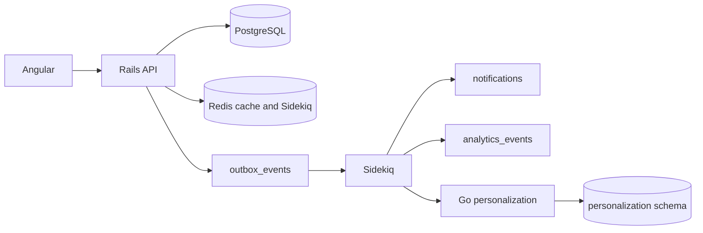

# Architecture

My Forum V1 is a modular monolith plus one recommendation service. It is meant to be joined, reviewed, and extended. It is not a microservice platform.

## System context

## Responsibilities

Rails is the system of record for users, organizations, topics, events, registrations, notifications, and the outbox. Controllers stay thin. `Events::Register` and `Topics::Follow` own multi-step workflows. Models own relationships and validations. PostgreSQL unique indexes and check constraints own the hard invariants, including `reserved_spots <= capacity`.

Pundit answers authorization. Authenticated users can read public events. An `organization_restricted` event is visible only to members of an organization listed in `event_allowed_organizations`, or to an admin of the organizing organization. The organizing organization is not automatically a viewer. Anonymous requests stop at authentication with 401. Listing, search, detail, and creating a registration all go through `EventPolicy` so a membership change is visible on the next request. Direct ids that fail the scope return 404. `GET /api/me/registrations` still returns the caller's own rows after they lose visibility, marked `event.viewable: false`, and `POST /api/registrations/cancel` cancels that row. A cancel for an event the caller cannot see and is not registered for stays 404.

Redis caches event detail JSON for 10 minutes, and only after `EventPolicy` allows the request. The unfiltered first page of upcoming events is cached per user for 1 minute. The key includes a fingerprint of that user's current organization memberships (read from Postgres, so `delete_all` and other callback-bypassing writes still change the key) and a global list epoch (bumped when an event or its allowed organizations change, including create, update, destroy, and registration capacity updates). Filtered searches are not cached. Old keys expire by TTL. Updating an event deletes the detail key, bumps the list epoch, and enqueues `RebuildEventCacheJob`. Redis is not required for readiness. If Redis is down, cached reads fail, but the database is still the source of truth.

Sidekiq queues are `default`, `notifications`, and `analytics`. `ProcessOutboxJob` claims pending outbox rows, dispatches them, and reschedules itself. Handlers are safe to run again: notifications and analytics rows are unique on an idempotency key, and the Go ingest stores processed keys.

The Go service keeps a read model in the `personalization` schema. Rails posts domain events to `POST /internal/events`. Ranking is deterministic: followed topics, location, a near-term boost, and a simple popularity fraction. There is no model training. Recommendation eligibility is not taken from that projection: `Candidates` keeps an event only when the live `events`, `event_allowed_organizations`, and `organization_memberships` rows say the user may see it.

## Sync and async

Registration commits the registration, the capacity increment, and the outbox row in one transaction. Notification delivery, analytics, and the recommendation update happen after commit. Search is a synchronous `ILIKE` query. That is intentional: it is correct at this size and is the seam where a later search service would attach.

## Observability

Request logs are JSON and include `request_id`, `user_id`, `duration_ms`, and `event_id` or `registration_id` when the request has them. Passwords and tokens are not logged.

`Metrics` keeps in-process counters for request count, request duration, and registration success or failure. Outbox lag is `Metrics.outbox_pending_age_seconds`. Sidekiq queue depth is available from Sidekiq's own API when Redis is up. These are names to scrape later. This version does not run Prometheus.

## What this version leaves open

PostgreSQL text search, a hand-written ranker, a polled outbox instead of a broker, analytics stored as rows, and registration still inside the Rails process. Those are the extension points. They are not broken behavior.
