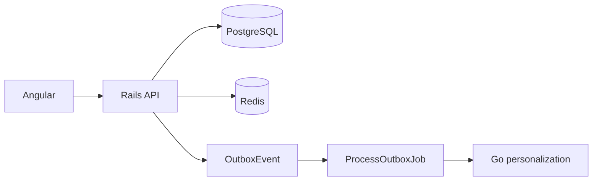

# Bootstrap report

My Forum V1 replaces the earlier Rails prototype in this git root. The monorepo is `backend/` (Rails 7.1 API), `frontend/` (Angular 19 standalone), `personalization/` (Go), and `docs/`. PostgreSQL is the source of truth. Redis is the cache and the Sidekiq broker. There is no nested `my-forum/` directory.

## Architecture

Rails owns users, organizations, memberships, topics, follows, events, speakers, registrations, notifications, the outbox, and analytics rows. `Events::Register` locks the event, rejects a duplicate or a full event, inserts a confirmed registration, increments `reserved_spots`, and writes a `RegistrationCreated` outbox row in the same transaction. `Topics::Follow` is idempotent and writes `TopicFollowed` only on the first follow.

`ProcessOutboxJob` claims pending outbox rows and dispatches in-process handlers. Those handlers enqueue `SendNotificationJob` and `RecordAnalyticsJob`, and POST the event to the Go service. The Go service stores a read model in the `personalization` schema and ranks with a deterministic score: topic overlap, location, a near-term boost, and popularity from reserved spots. Angular talks only to Rails and sends the JWT from `AuthInterceptor`.

## What landed

- JWT session auth, Pundit `EventPolicy` (authenticated users can read every public event; only an org admin can update or destroy), and central JSON errors on `Api::BaseController`.
- Event discovery filters (`q`, `topic_id`, `location`, `upcoming`), event detail cache, upcoming-list cache, registration, topic follow and unfollow, my registrations, and my notifications.
- `GET /health` and `GET /ready` (Postgres only).
- Seeds: 8 organizations, 30 users, 15 topics, 100 events, speakers, follows, and a mix of empty, popular, and nearly full events. Password is `password`. `alex@example.com` is the first admin.
- RSpec for registration success, duplicate, full, rollback, concurrent capacity, follow idempotency, policy, outbox publish, and the main API endpoints.
- Go health, readiness, recommendations, ingest, ranking, and handler tests.
- Angular login, discovery, event detail with register, registrations, topics, and notifications.
- Compose for Postgres (host port 5433) and Redis, plus `make setup`, `make test`, and `make dev`.
- README, architecture, registration flow, and ADRs `0001`–`0004`.

## Commands and results

These commands were run on this machine. A check is listed only if it was executed.

| Command | Result |
|---|---|
| `cd backend && bundle exec rspec --format progress` | 18 examples, 0 failures (seed 20081). Re-run after pinning `connection_pool` and `redis`. |
| `cd personalization && go test ./...` | `internal/httpapi`, `internal/ranking`, and `internal/store` ok. `cmd/personalization` has no test files. |
| `cd frontend && npx ng build --configuration=development` | Succeeded. Initial bundle about 1.74 MB. |
| `cd frontend && npx ng test --watch=false --browsers=ChromeHeadless` | 2 examples, 0 failures (Chrome Headless 155). |
| `curl http://127.0.0.1:3000/health` and `/ready` | Both 200: `{"status":"ok"}` and `{"status":"ready"}`. |

`make test` was not run as a single command. The three suites above are what that target invokes.

Browser check against `bin/rails server` on port 3000 and `ng serve` on port 4200, signed in as `alex@example.com`:

- Login reached the upcoming event list.
- Location filter `Online` returned only online events.
- Event 6 detail showed the description, speaker, and capacity, and register returned “You are registered.” Rails logged `201` with `registration_id` 395 and an outbox insert in the same request.
- Topics follow changed Cities from Follow to Unfollow; unfollow was then clicked.
- My registrations listed Forum session 6 as confirmed.
- Notifications showed the seeded “Registration confirmed” row.
- Log out returned to `/login`, and opening `/events` redirected back to login.

The Go process and Sidekiq were not started for that pass, so the new registration’s notification and recommendation update were not delivered live. The outbox row was written.

## Fix found while booting

Rails 7.1’s Redis cache store passes a positional options hash to `ConnectionPool.new`. `connection_pool` 3.0 rejects that and the server exits before listen. The Gemfile pins `connection_pool` `~> 2.4` and `redis` `~> 5.3`, which Sidekiq 7.3 accepts. Development and production both use the Redis cache store.

## Known limits

These are intentional, and they are also the extension points:

- Search is PostgreSQL `ILIKE` on title and description.
- Ranking is a fixed formula, not a model.
- Only event detail and the unfiltered first upcoming page are cached.
- The outbox is polled by one `ProcessOutboxJob`. Enqueue it once. A second poller is not coordinated.
- Analytics are rows in `analytics_events`.
- Registration stays inside the Rails process. Status values `pending`, `cancelled`, and `failed` exist on the column. V1 has no cancel API and no payment provider.
- Readiness checks Postgres only. A down Redis breaks cached reads and Sidekiq, and `/ready` can still be green.
- The Go service was unit-tested with the in-memory store. It was not exercised against a live `personalization` schema in this run.

## Files to read first

- `backend/app/services/events/register.rb` — capacity lock and outbox write
- `backend/app/services/outbox/publisher.rb` and `dispatcher.rb` — poll and handlers
- `backend/app/policies/event_policy.rb` — who can see and change events
- `backend/config/routes.rb` — HTTP surface
- `personalization/internal/ranking/ranker.go` — score
- `personalization/cmd/personalization/main.go` — process entry
- `frontend/src/app/app.routes.ts` and `frontend/src/app/core/forum-api.ts` — client routes and API
- `docs/architecture.md` and `docs/registration-flow.md`
