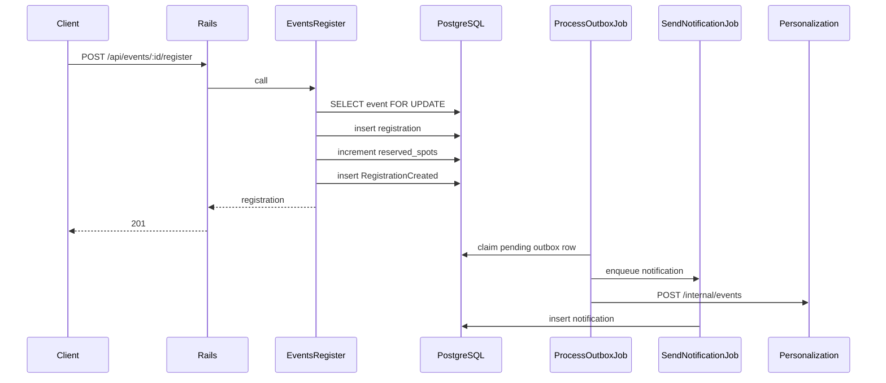

# Registration flow

Registering commits the business change and the outbox row together. Side effects run after that commit.

`Events::Register` locks the event row, rejects an existing registration, and rejects the call when `reserved_spots` is already at `capacity`. The unique index on `(user_id, event_id)` is the backstop for a duplicate insert. The check constraint `reserved_spots <= capacity` is the backstop for an oversell. A failed outbox insert rolls the registration back.

Duplicate registration returns 409 `duplicate_registration`. A full event returns 409 `event_full`. There is no payment step. The registration is stored as `confirmed`. The `pending`, `cancelled`, and `failed` statuses exist for a later payment or cancellation ticket.

`ProcessOutboxJob` marks a row published only after dispatch returns. Notification and analytics inserts ignore a repeated idempotency key. The Go service does the same with `processed_events`.
