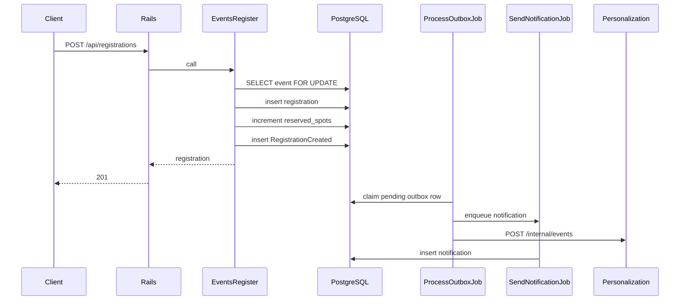

# Registration flow

Registering commits the business change and the outbox row together. Side effects run after that commit.

`Events::Register` locks the event row, rejects a registration that is already confirmed, and rejects the call when `reserved_spots` is already at `capacity`. A cancelled registration for the same user and event is confirmed again and reserves another spot. The unique index on `(user_id, event_id)` is the backstop for a duplicate insert. The check constraint `reserved_spots <= capacity` is the backstop for an oversell. A failed outbox insert rolls the registration back.

`POST /api/registrations/cancel` locks the same event. A confirmed registration can be cancelled only while `starts_at` is still in the future. It then becomes `cancelled`, frees one spot, and writes `RegistrationCancelled`. Cancelling at or after the start returns 422 `event_started` and leaves the spot reserved. A second cancel of an already cancelled row does not free another spot. If a confirmed row exists while `reserved_spots` is already zero, the transaction fails and the counter is left unchanged. Cancelling when there is no row returns 404 `user_not_registered` for an event the caller can still see, and 404 `not_found` when they cannot see it. Losing visibility does not block cancel. The cancel response and `GET /api/me/registrations` include event title, time, and location only while the caller can still view the event.

Outbox idempotency keys include `lifecycle_version`, so a later create or cancel cycle writes a new row and a retry of the same cycle does not.

Duplicate registration returns 409 `duplicate_registration`. A full event returns 409 `event_full`. There is no payment step. New registrations are stored as `confirmed`. `failed` remains on the column and cannot be cancelled or reopened.

`ProcessOutboxJob` marks a row published only after dispatch returns. Notification and analytics inserts ignore a repeated idempotency key. The Go service does the same with `processed_events`.

## Organizer cancellation

An organizer admin cancels a published event that has not started with `POST /api/events/:id/cancel`. `PATCH` cannot cancel, and neither can any plain status write: only the state machine's `cancel` event, fired by `Events::Cancel`, may. `Events::Cancel` locks the event, moves it to `cancelled` through the `Event` state machine, sets `cancelled_at`, and writes one `EventCancelled` outbox row (key `event_cancelled:<id>`). Cancelling an already cancelled event returns it unchanged. A draft cannot be cancelled; delete it instead.

The dispatcher hands `EventCancelled` to `CancelEventRegistrationsJob`. For each confirmed registration, in its own transaction, the job locks the registration, then the user. It cancels the registration with `cancelled_by: "organizer"` and, unless the user switched off `event_cancelled_enabled`, writes one `event_cancelled` notification keyed `notification:event_cancelled:<registration id>`. A registration that is no longer confirmed is skipped, so reruns and a participant's own earlier cancel are left alone. No `RegistrationCancelled` row is written, so registrants get one notification, not two. The event row is not locked per registration; after the loop, one statement sets `reserved_spots` to the count of registrations still confirmed, and the cache is invalidated once. The job does nothing for an event that is not cancelled.

Until the job reaches a registration it still reads `confirmed`; clients use the event's `status` in the registration's `event` summary to show the event as cancelled. Stuck cascades show up in `Metrics.cancelled_events_with_confirmed_registrations` and are resumed with `bin/rails events:resume_cancellations`.
