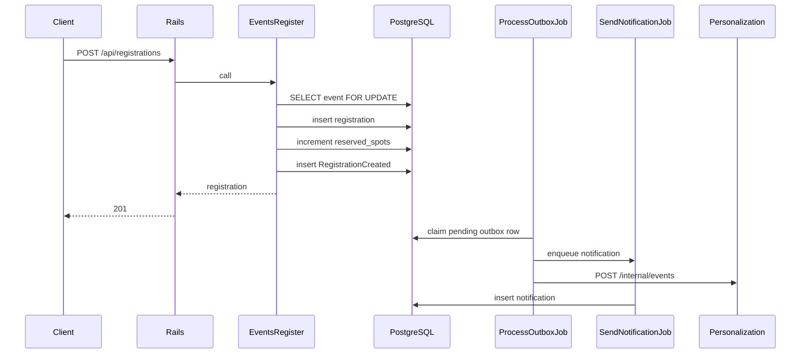

# Registration flow

Registering commits the business change and the outbox row together. Side effects run after that commit.

`Events::Register` locks the event row, rejects a registration that is already confirmed, and rejects the call when `reserved_spots` is already at `capacity`. A cancelled registration for the same user and event is confirmed again and reserves another spot. The unique index on `(user_id, event_id)` is the backstop for a duplicate insert. The check constraint `reserved_spots <= capacity` is the backstop for an oversell. A failed outbox insert rolls the registration back.

`POST /api/registrations/cancel` locks the same event. A confirmed registration becomes `cancelled`, frees one spot, and writes `RegistrationCancelled`. A second cancel of that row does not free another spot. Cancelling when there is no row returns 404 `user_not_registered` for an event the caller can still see, and 404 `not_found` when they cannot see it. Losing visibility does not block cancel: the caller's own registration is enough.

Outbox idempotency keys include `lifecycle_version`, so a later create or cancel cycle writes a new row and a retry of the same cycle does not.

Duplicate registration returns 409 `duplicate_registration`. A full event returns 409 `event_full`. There is no payment step. New registrations are stored as `confirmed`. `failed` remains on the column and cannot be cancelled or reopened.

`ProcessOutboxJob` marks a row published only after dispatch returns. Notification and analytics inserts ignore a repeated idempotency key. The Go service does the same with `processed_events`.
